# Fluxos de usuário por persona

Desafio 1: Conecta Recife. Os blocos e itens abaixo foram lidos da API pública em 13/11/2026 (`GET /recomendacao/{id}/home`). As etapas dos pedidos vêm do `API.md` e dos requisitos. Dados 100% fictícios.

## 1. Fluxo base (vale para todas as personas)

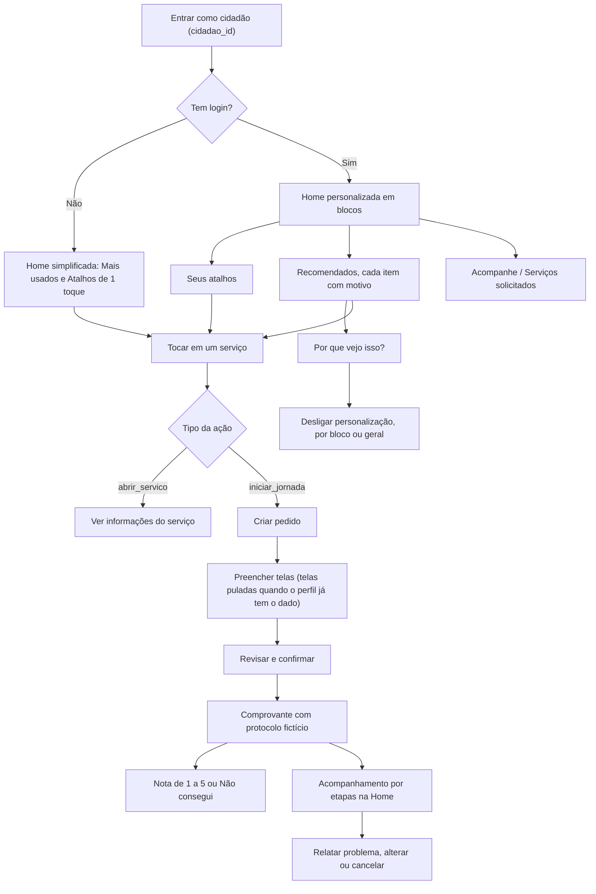

Regras que valem em todos os fluxos:
- Saúde e acessibilidade têm consentimentos separados. Sem consentimento, o servidor não lê esses dados.
- Nenhum título de bloco cita condição de saúde ou deficiência.
- Quem já está no Cadastro Único não recebe "Inscrever-se". O Bolsa Família aparece como status.
- Visitante não é ligado a cidadão. As visitas sem login servem só para estatística.

## 2. Fluxos por persona

### 2.1 Idosa (C007938), 68 anos, RPA 3

Perfil: sem marcadores. Histórico: 519, 1475, 953.

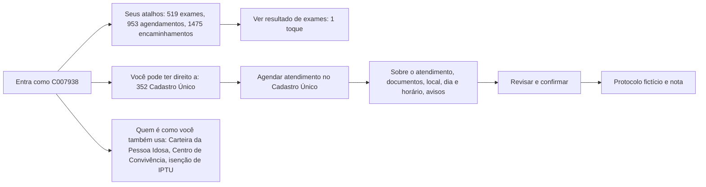

Ponto de atenção: o bloco "Nesta época do ano" traz serviço de pets e trilhas, iguais ao das outras personas. Para ela, a relevância é fraca.

### 2.2 Microempreendedor (C068579), 42 anos, RPA 6

Perfil: empreendedora e MEI. Histórico: 953, 942, 1475.

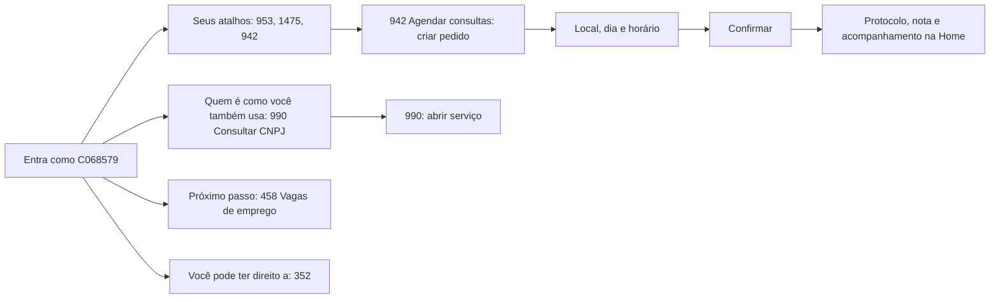

### 2.3 Pessoa com deficiência (C059592), 63 anos, RPA 5

Perfil: tutora de animal, Cadastro Único, hipertensão, PCD. Histórico: IPTU, Centro da Pessoa Idosa, 771, 481.

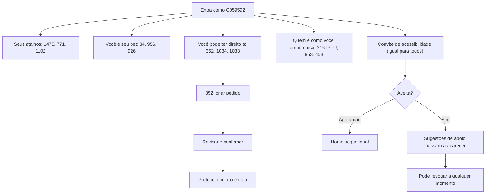

Pontos de atenção:
- O convite de acessibilidade é o mesmo para todos, para não revelar quem tem deficiência.
- O texto atual diz "você é pessoa com deficiência, que já consta no seu cadastro". Isso é falso para a maioria e precisa ser trocado por texto neutro.
- A interface não muda sem o pedido da pessoa. O marcador só influencia sugestões, e apenas com consentimento.

### 2.4 Jovem estudante (C036462), 19 anos, RPA 2

Perfil: tutora, estudante, gestante (marcador sensível). Histórico: 519, 892, 1349.

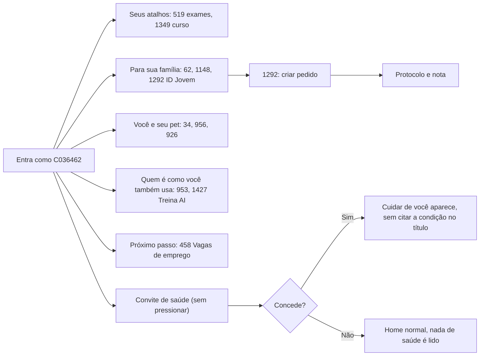

Pontos de atenção:
- O bloco "Para sua família" traz conteúdo para jovens. O título não combina com o conteúdo.
- O marcador `gestante` não aparece na Home sem consentimento. Confirmei que nenhum termo de saúde apareceu nos itens.

### 2.5 Família no Cadastro Único (C039227), 26 anos, RPA 4

Perfil: homem, tutor, Cadastro Único, Bolsa Família, pobreza. Histórico: 910, 1210, 1047.

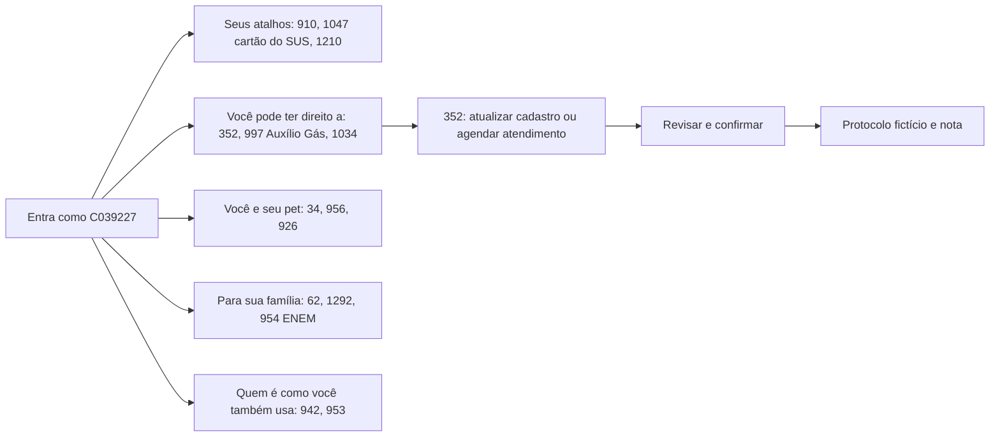

Regra: como já tem Cadastro Único e Bolsa Família, o app mostra atualizar cadastro e agendar atendimento, nunca inscrever-se.

### 2.6 Família com criança (C076260), 25 anos, RPA 5

Perfil: Cadastro Único, Bolsa Família, criança de 7 a 11 anos. 17 visitas. Os blocos desta persona são definidos pela equipe (Home fixa).

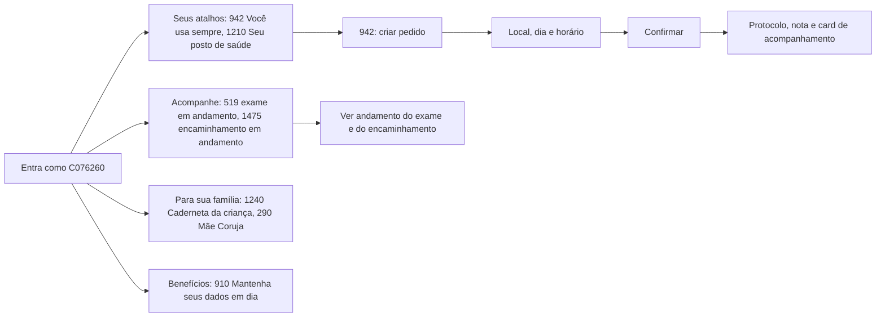

Ponto de atenção: esta é a melhor persona para a demo da família, porque os blocos fazem sentido para uma mãe com criança.

### 2.7 Gestante (C006566), 37 anos, RPA 6

Perfil: Cadastro Único, Bolsa Família, gestante, extrema pobreza, adolescente na família. Histórico: 519, 1475, 892.

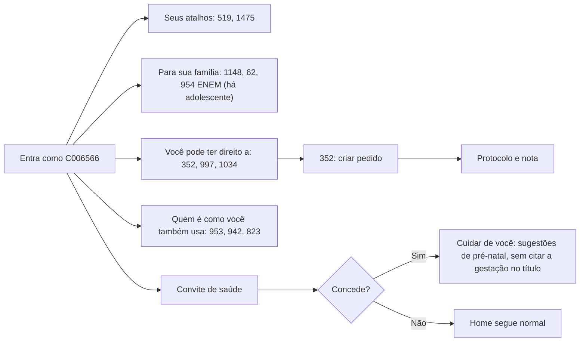

Observação: a gestação é provável, indicada pela rede de saúde, e não confirmação clínica. O texto nunca deve afirmar.

### 2.8 Doença crônica (C062244), 70 anos, RPA 6

Perfil: tutor de animal, Cadastro Único, hipertensão e diabetes. Home fixa definida pela equipe.

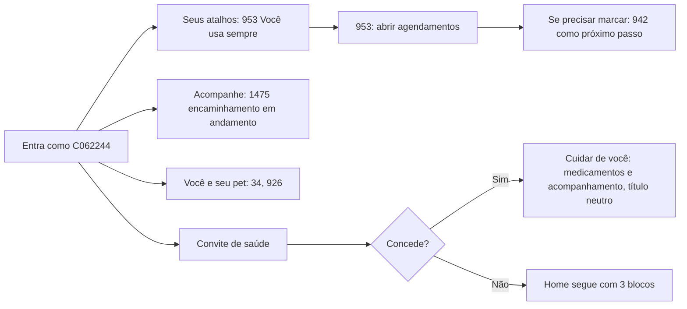

Ponto de atenção: a Home atual tem só 3 blocos e 4 itens. É simples, o que ajuda um senhor de 70 anos, mas mostra pouco serviço novo.

### 2.9 Visitante sem login

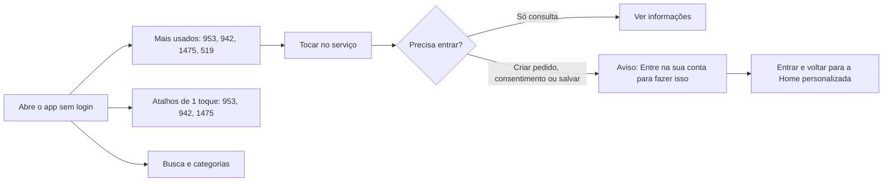

Observação: o servidor responde 403 com `login_necessario` e mensagem em texto simples.

### 2.10 Cidadão com pouco ou nenhum histórico

Este fluxo não foi testado na API para um ID real. Segue a regra dos requisitos.

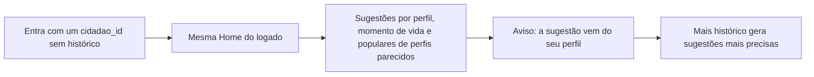

## 3. Jornada do pedido (os dois serviços)

| Serviço | Etapas no app | Fora do app ("O que fazer depois") |
|---|---|---|
| 352 Agendar atendimento no Cadastro Único | Sobre o atendimento, documentos, local, dia e horário, avisos, revisar e confirmar | Comparecer ao local com os documentos, fazer a entrevista, esperar 48 horas pelo NIS |
| 942 Agendar consultas e procedimentos | Local, dia e horário, confirmar (definidas pela equipe, apresentadas como simulação) | — |

Pedido de demonstração (cidadã `DEMO001`):
- `J-DEMO0001`: serviço 942, etapa 2 de 4 "Aguardando confirmação da unidade", protocolo `CNX-2026-000123`.
- `J-DEMO0002`: serviço 352, etapa 4 de 4, concluído, ainda sem avaliação.
- Avançar ao vivo: `POST /demo/jornadas/J-DEMO0001/avancar`. Reiniciar: `POST /demo/reiniciar`.

## 4. O que cada comparação mostra na apresentação

| Comparação | O que destacar |
|---|---|
| Visitante x C076260 | Home genérica contra Home de mãe com criança |
| C062244 x C076260 | Foco só em saúde contra família e benefícios |
| C007938 x C039227 | Idosa sem marcadores contra família no Cadastro Único e pet |
| Qualquer logado x sem histórico | Mesma tela, com aviso de base no perfil |

## 5. Fraquezas vistas nos dados reais da API

1. O bloco "Nesta época do ano" traz os mesmos serviços (1183, 1303, 1459) para quase todas as personas, inclusive serviço de pet para quem não tem pet. Relevância fraca.
2. O bloco "Para sua família" aparece para C036462 e C039227 com conteúdo para jovens. O título não combina com o conteúdo.
3. O serviço novo "Pessoas como você também usam" não apareceu para C059592, C062244, C039227 e C076260. A checagem foi por texto e pode estar errada.
4. O convite de acessibilidade usa uma frase que afirma deficiência para todos.
5. Os fluxos 2.6 e 2.8 vêm de Home fixa escrita pela equipe. Diga isso se perguntarem, e não apresente como resultado do motor.
6. Eu não percorri os pedidos de ponta a ponta nas telas do Kodiak. Os fluxos de pedido acima seguem o `API.md` e os requisitos.
