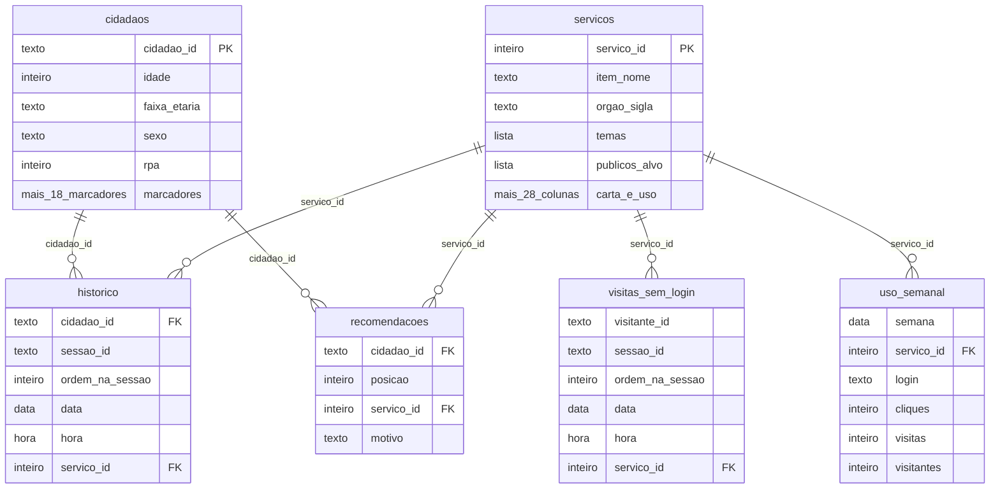

# Guia dos dados

**Desafio Hiperpersonalização de Serviços · Conecta Recife · dados, dicas e o que será avaliado**

> **O desafio:** como podemos melhorar a experiência do cidadão no Conecta Recife por meio da hiperpersonalização dos serviços, de modo que cada pessoa encontre, inicie e conclua o que precisa de forma clara, acessível e simples pelo celular?

### O resultado esperado

1. **Um protótipo funcional no celular.** Ao escolher um cidadão de `cidadaos.csv`, ele mostra os serviços certos para essa pessoa, diz por que cada um aparece e leva até a conclusão de pelo menos um serviço.
2. **Uma apresentação curta** com as dores escolhidas, as decisões tomadas e como o resultado seria medido.
3. **Opcional:** `recomendacoes.csv`, com até 10 sugestões para cada um dos 89.046 cidadãos. É o que permite medir com dados a qualidade das sugestões (seção 6).

---

## 1. O que tem na pasta

| Arquivo | O que é | Origem | Linhas |
|---|---|---|---:|
| `servicos.csv` | Serviços (Carta de Serviços) | Real: catálogo público e números agregados | 843 |
| `cidadaos.csv` | Cidadãos simulados | Simulado a partir de proporções reais | 89.046 |
| `historico.csv` | Histórico de visitas (simulado) | Simulado a partir de padrões reais agregados | 593.056 |
| `visitas_sem_login.csv` | Visitas sem login (simuladas) | Simulado a partir de padrões reais agregados | 3.563.242 |
| `uso_semanal.csv` | Tendências de uso (reais) | Real, agregado | 11.587 |
| `dados_em_planilha.xlsx` | Os mesmos dados dos CSV em planilha (uma aba por arquivo), menos `visitas_sem_login`, que passa do limite de linhas do Excel | Para abrir no Excel | — |

### Como os arquivos se ligam



Os campos `cidadao_id` e `servico_id` ligam os arquivos; `1` e `N` indicam uma linha de um lado e várias do outro. `visitas_sem_login` só se liga pelos serviços. `recomendacoes.csv` é o arquivo que a equipe pode entregar.

### Visita (sessão): o que liga os cliques

Uma visita, ou sessão, é um uso contínuo do app: os cliques que a pessoa faz de uma vez, do primeiro serviço que abre até parar de usar o app. É a unidade que dá sentido aos cliques. Os serviços abertos numa mesma visita mostram o que a pessoa buscava naquele momento, e a ordem mostra o caminho que ela fez no app. Visitas diferentes da mesma pessoa mostram como o interesse dela muda com o tempo. Em `visitas_sem_login`, que não tem perfil, a visita é o principal contexto de cada clique.

- `sessao_id` identifica a visita: todos os cliques dela têm o mesmo código, e o código não se repete em nenhuma outra visita, nem entre `historico` e `visitas_sem_login`.
- `ordem_na_sessao` numera os cliques dentro da visita (1 = primeiro). Use-a para ordenar os cliques de uma visita: a hora tem precisão de minuto, e em 91% das visitas todos os cliques têm a mesma hora.
- Uma visita é sempre de uma só pessoa (ou de um só visitante). Uma pessoa pode fazer várias visitas, inclusive no mesmo dia: dois cliques do mesmo dia não são, necessariamente, da mesma visita.
- Numa visita, o mesmo serviço não aparece duas vezes seguidas. Uma visita pode passar da meia-noite e ter cliques em duas datas.

**Exemplo real de `historico.csv`:** as duas visitas do cidadão C002780 (o nome do serviço vem de `servicos.csv`).

| sessao_id | ordem_na_sessao | data | hora | servico_id | Serviço |
|---|---:|---|---|---:|---|
| 84ffde404b31 | 1 | 06/08/2026 | 20:22 | 458 | Vagas de emprego |
| 84ffde404b31 | 2 | 06/08/2026 | 20:22 | 1359 | AGENDAR CURSO Marketing Digital |
| 84ffde404b31 | 3 | 06/08/2026 | 20:23 | 1349 | AGENDAR CURSO Design de Sobrancelhas |
| 9e0973a822b2 | 1 | 26/08/2026 | 22:47 | 458 | Vagas de emprego |

Na primeira visita, o cidadão abriu três serviços seguidos, na ordem 1, 2 e 3; na segunda, outro dia, abriu um.

### Formato dos arquivos CSV

| Item | Padrão |
|---|---|
| Codificação | UTF-8, sem BOM |
| Separador de colunas | vírgula (`,`) |
| Primeira linha | cabeçalho com o nome das colunas |
| Textos | entre aspas duplas quando têm vírgula, aspas ou quebra de linha; aspas dentro do texto aparecem duplicadas (`""`). É o padrão RFC 4180 |
| Quebra de linha | LF (`\n`), inclusive dentro dos textos longos de `servicos.csv` |
| Números decimais | ponto (`4.26`) |
| Verdadeiro e falso | `true` e `false` |
| Datas e horas | `AAAA-MM-DD` e `HH:MM` |
| Listas numa célula | separadas por `\|` (temas, grupos, públicos-alvo, palavras-chave) |
| Célula vazia | sem informação, ou abaixo do mínimo de 10 pessoas ou aparelhos, quando a coluna indicar |

### Como abrir

- **Python:** `pd.read_csv("servicos.csv", keep_default_na=False)` (o parâmetro mantém as células vazias como texto vazio).
- **R:** `readr::read_csv("servicos.csv")`.
- **Excel:** use `dados_em_planilha.xlsx`. Abrir o CSV com duplo clique no Excel em português quebra os acentos, as colunas e os textos com várias linhas.

---

## 2. Dados simulados e privacidade

Os cidadãos, os visitantes e os históricos são **simulados**. Nenhum cidadão de `cidadaos.csv` é uma pessoa real, nenhum visitante é um aparelho real e nenhum histórico é o de alguém. Eles foram gerados a partir de proporções e padrões reais de uso do app, calculados sempre sobre grupos de pelo menos 10 pessoas ou aparelhos.

São **reais** a Carta de Serviços (pública), a popularidade e as notas dos serviços, e as tendências semanais, todas em números agregados.

- **Dados de saúde exigem cuidado.** Mesmo fictícios aqui, no app real eles só podem personalizar a experiência com consentimento do cidadão. Mostre como a solução pede, explica e respeita esse consentimento.
- No protótipo, use só dados fictícios. Não digite CPF, nome ou endereço reais, nem de colegas.
- Use os dados só para o desafio, não os redistribua e apague-os ao fim do evento.

---

## 3. O que os dados oferecem para cada funcionalidade

As 7 funcionalidades do briefing. A equipe não precisa fazer todas: escolha as mais críticas e justifique na apresentação.

| Funcionalidade | Dados que ajudam | Dica | A equipe simula |
|---|---|---|---|
| **1. Vitrine personalizada** | `cidadaos` (perfil), `historico` (o que já usou), `servicos` (público-alvo, temas, natureza, canais) | Comece por 2 ou 3 personas e pergunte o que cada uma precisa ver primeiro. No celular, poucos itens bem escolhidos valem mais que uma lista longa. | — |
| **2. Atalhos e sugestões** | `historico` (sequência e datas), `visitas_sem_login` (padrões de uso, mesmo sem perfil), `servicos` (passos e requisitos), `uso_semanal` (épocas de procura) | O momento de vida não vem pronto em nenhuma coluna: precisa ser percebido no histórico e no perfil. O próximo passo pode ser outro serviço ou uma etapa do mesmo. | Prazos e datas-limite (a Carta não tem). |
| **3. Jornada simplificada de um serviço** | `servicos` (requisitos, passos, canais, natureza, gratuito) | Escolha um serviço que importe para as suas personas. Reescreva requisitos e passos em linguagem simples e peça só o necessário. | Dados do formulário: use dados fictícios, nunca CPF ou documento real. |
| **4. Confirmação, comprovante e acompanhamento** | `servicos` (passos, como base das etapas do pedido) | Mostre o que acontece depois de enviar: número de protocolo, próximos passos e linha do tempo. | Protocolo, status e tempo de cada etapa. |
| **5. Acessibilidade** | `cidadaos` (idade, pessoa com deficiência), textos de `servicos` | Contraste, tamanho de toque, leitor de tela e linguagem simples desde a primeira tela. | Necessidades específicas de acessibilidade. |
| **6. Preferências e privacidade** | Marcadores de `cidadaos` e o uso em `historico` | Mostre por que cada sugestão aparece e deixe o cidadão desligar o que não quiser. Use só os dados necessários. | Consentimento e preferências. |
| **7. Indicadores de experiência e conversão** | `servicos` (`nota_media`, `cliques_historico`), `uso_semanal` | Defina o que vai medir (conclusão, abandono por etapa, tempo, satisfação) e instrumente o protótipo. | Etapas, tempo e abandono (não estão nos dados). |

---

## 4. Personas para demonstrar o protótipo

O briefing pede uma vitrine que muda conforme o perfil, o histórico e o momento de vida do cidadão. Para mostrar isso, o protótipo precisa de cidadãos de exemplo. Abaixo estão oito cidadãos de `cidadaos.csv`, um para cada perfil citado no briefing, escolhidos por terem histórico suficiente para a demonstração.

### Como usar

1. No protótipo, crie uma forma de "entrar como" um cidadão, pelo `cidadao_id`.
2. Ao escolher um cidadão, carregue o perfil dele (`cidadaos.csv`) e o histórico (`historico.csv`).
3. Mostre como a vitrine, as sugestões e os avisos mudam de um cidadão para outro. Na apresentação, compare pelo menos dois lado a lado.
4. A solução deve funcionar com **qualquer** `cidadao_id`: os jurados podem pedir para abrir outros cidadãos durante a apresentação.

Cada cartão traz o perfil do cidadão, quantas visitas ele fez ao app e os serviços que usou por último.

#### Idosa — C007938

Mulher, 68 anos, RPA 3; nenhum marcador. 3 visitas; a última em 11/09/2026. Serviços mais recentes:

- Ver resultado de exames laboratoriais (519)
- Ver meus encaminhamentos (1475)
- Ver meus agendamentos de Saúde (953)

#### Microempreendedor — C068579

Mulher, 42 anos, RPA 6; empreendedor, MEI, aceita avisos. 5 visitas; a última em 16/09/2026. Serviços mais recentes:

- Ver meus agendamentos de Saúde (953)
- Agendar consultas e procedimentos na Minha Unidade de Saúde (942)
- Ver meus encaminhamentos (1475)

#### Pessoa com deficiência — C059592

Mulher, 63 anos, RPA 5; tutor de animal, pessoa com deficiência, Cadastro Único, hipertensão, aceita avisos. 11 visitas; a última em 19/08/2026. Serviços mais recentes:

- Solicitar isenção de IPTU prevista no Código Tributário (216)
- Visitar Centro da Pessoa Idosa Maria da Conceição (1428)
- Cadastrar serviços autônomos no GO Recife (771)
- Emitir Carteira de Trabalho Digital (CTPS) (481)

#### Jovem estudante — C036462

Mulher, 19 anos, RPA 2; tutor de animal, estudante, gestante, aceita avisos. 3 visitas; a última em 07/07/2026. Serviços mais recentes:

- Ver resultado de exames laboratoriais (519)
- Atendimento online Atende Gestante (892)
- AGENDAR CURSO Design de Sobrancelhas (1349)

#### Família no Cadastro Único — C039227

Homem, 26 anos, RPA 4; tutor de animal, Cadastro Único, Bolsa Família, aceita avisos, pobreza. 3 visitas; a última em 26/09/2026. Serviços mais recentes:

- Atualizar cadastro para consultas e exames (910)
- Buscar unidade de saúde por cadastro (1210)
- Acessar meu cartão do SUS (1047)

#### Família com criança — C076260

Mulher, 25 anos, RPA 5; Cadastro Único, Bolsa Família, criança de 7 a 11 anos na família. 17 visitas; a última em 01/09/2026. Serviços mais recentes:

- Ver resultado de exames laboratoriais (519)
- Agendar consultas e procedimentos na Minha Unidade de Saúde (942)
- Atualizar cadastro para consultas e exames (910)
- Ver meus encaminhamentos (1475)

#### Gestante — C006566

Mulher, 37 anos, RPA 6; Cadastro Único, Bolsa Família, gestante, aceita avisos, extrema pobreza, adolescente na família. 4 visitas; a última em 17/08/2026. Serviços mais recentes:

- Ver resultado de exames laboratoriais (519)
- Ver meus encaminhamentos (1475)
- Atendimento online Atende Gestante (892)

#### Doença crônica — C062244

Homem, 70 anos, RPA 6; tutor de animal, Cadastro Único, hipertensão, diabetes, aceita avisos. 3 visitas; a última em 16/08/2026. Serviços mais recentes:

- Ver meus agendamentos de Saúde (953)
- Ver meus encaminhamentos (1475)

---

## 5. Dicionário de dados

### `servicos.csv` — Serviços (Carta de Serviços)

843 linhas · chave: `servico_id` · Real: catálogo público e números agregados

O catálogo: uma linha por serviço da Carta de Serviços do Conecta Recife (843), com nome, órgão, tema, público-alvo, descrição, requisitos, passo a passo, canais e maturidade digital, mais a popularidade e a nota reais.

**Como usar**

- Junte com os outros arquivos por `servico_id`.
- Colunas de lista vêm separadas por `|`; textos longos têm quebras de linha e itens iniciados por `-`.
- `tem_historico`: 558 serviços aparecem em `historico.csv`; os demais não aparecem nele.

**Exemplo**

```
servico_id=1 item_nome="Solicitar registro de imóvel adquirido em leilão" orgao_sigla=SEFIN
temas=Imóveis publicos_alvo=Proprietário de imóveis natureza=Peticionador (formulário)
gratuito=true nivel_digital_atual=3 canal_web=https://recifeemdia.recife.pe.gov.br/...
```

| Coluna | Tipo | O que representa |
|---|---|---|
| **Identificação e órgão** | | |
| `servico_id` | inteiro | Identificador do serviço. |
| `item_nome` | texto | Nome mostrado no app. |
| `nome` | texto | Nome completo. |
| `nome_resumido` | texto | Nome curto. |
| `orgao_nome` | texto | Órgão responsável. |
| `orgao_sigla` | texto | Sigla do órgão. |
| **Classificação e público** | | |
| `temas` | lista | Temas (Saúde, Cidadania, Mobilidade...). |
| `grupos` | lista | Grupos de serviços na Carta. |
| `publicos_alvo` | lista | A quem o serviço se destina (Idoso, Empreendedor, Pessoa com deficiência - PCD, Criança...). |
| `palavras_chave` | lista | Palavras-chave. |
| `natureza` | texto | Tipo: Peticionador (formulário), Agendamento, Informativo, Emissão de documentos, Plataforma, Inscrição, Consulta etc. |
| **Conteúdo** | | |
| `descricao` | texto | Descrição. |
| `requisitos` | texto | Documentos e condições. |
| `passos` | texto | Passo a passo. |
| `manifestacao` | texto | Como se manifestar sobre o serviço. |
| `prioridade_atendimento` | texto | Quem tem prioridade. |
| `gratuito` | verdadeiro/falso | Se é gratuito. |
| **Canais e maturidade digital** | | |
| `canal_web` | texto (URL) | Endereço na web. |
| `canal_app` | texto | Atalho no app (código - nome). |
| `canal_chat` | texto | Canal de chat. |
| `selo_acesso` | inteiro (0 a 2) | Selo de maturidade digital: 0 nenhum, 1 bronze, 2 prata. |
| `selo_acesso_descricao` | texto | O selo em texto. |
| `nivel_digital_atual` | inteiro (0 a 4) | 0 Físico, 1 Parcialmente digital, 2 Digital primitivo, 3 Digital redirecionamento, 4 Digital nativo. Vazio = a classificar. |
| `nivel_digital_ideal` | inteiro (0 a 4) | Nível desejado, na mesma escala. |
| `status_atual` | texto | Nível atual em texto. |
| `status_ideal` | texto | Nível desejado em texto. |
| **Uso e satisfação (reais, agregados)** | | |
| `ultima_atualizacao` | data | Última atualização do cadastro do serviço. |
| `cliques_historico` | inteiro | Cliques no app de 10/06/2025 a 27/09/2026, identificados ou não. Vazio quando menos de 10 pessoas e aparelhos clicaram. |
| `pessoas_unicas_historico` | inteiro | Pessoas identificadas que clicaram no mesmo período. Vazio quando menor que 10. |
| `aparelhos_sem_login_historico` | inteiro | Aparelhos com cliques sem identificação no mesmo período. Vazio quando menor que 10. |
| `nota_media` | decimal | Nota média dada pelos cidadãos (1 a 5). Vazio quando há menos de 10 notas. |
| `avaliacoes_com_nota` | inteiro | Quantas notas compõem a média. |
| `tem_historico` | verdadeiro/falso | Se o serviço aparece em `historico.csv`. |

### `cidadaos.csv` — Cidadãos simulados

89.046 linhas · chave: `cidadao_id` · Simulado a partir de proporções reais

89.046 cidadãos fictícios. A combinação de idade, sexo, região e marcadores segue as proporções reais, mas nenhuma linha é uma pessoa real.

**Como usar**

- Os marcadores são `true` ou `false` e podem se combinar (uma pessoa pode ser MEI, tutora de animal e estar no Cadastro Único).
- 5.778 cidadãos ainda não têm visitas em `historico.csv`: são como quem acabou de chegar ao app.
- Os marcadores de saúde (hipertensão, diabetes, saúde mental, gestante) são de cidadãos fictícios. No app real, usá-los para personalizar exige consentimento do cidadão (LGPD art. 11): mostre como a solução pediria e respeitaria esse consentimento.
- `criancas_na_familia` só é conhecido para quem está no Cadastro Único, que registra a composição da família. Vazio quer dizer sem informação, não "sem criança".

**Exemplo**

```csv
cidadao_id,idade,faixa_etaria,sexo,rpa,empreendedor,mei,servidor_publico,proprietario_imovel,tutor_animal,estudante,pessoa_com_deficiencia,cadastro_unico,bolsa_familia,usuario_compaz,hipertensao,diabetes,saude_mental,gestante,microcredito,aceita_notificacao,situacao_renda,criancas_na_familia
C000001,35,35-44,F,3,false,false,false,false,false,false,false,true,true,false,false,false,true,true,false,true,pobreza,crianca
```

| Coluna | Tipo | O que representa |
|---|---|---|
| `cidadao_id` | texto | Identificador do cidadão simulado (C000001...). |
| `idade` | inteiro | Idade. |
| `faixa_etaria` | texto | 18-24, 25-34, 35-44, 45-59, 60-74 ou 75+. |
| `sexo` | texto | F ou M. |
| `rpa` | inteiro (1 a 6) | Região Político-Administrativa do Recife onde mora. |
| `empreendedor` | verdadeiro/falso | Tem empresa, inscrição mercantil ou pediu microcrédito (14%). |
| `mei` | verdadeiro/falso | Microempreendedor individual (9%). |
| `servidor_publico` | verdadeiro/falso | Servidor municipal ativo (3%). |
| `proprietario_imovel` | verdadeiro/falso | Tem vínculo com imóvel no Recife (10%). |
| `tutor_animal` | verdadeiro/falso | Tutor de animal (17%). |
| `estudante` | verdadeiro/falso | Estudante em programa municipal ou bolsista (2%). |
| `pessoa_com_deficiencia` | verdadeiro/falso | Pessoa com deficiência (2%). |
| `cadastro_unico` | verdadeiro/falso | Família no Cadastro Único, porta de entrada dos programas sociais (49%). |
| `bolsa_familia` | verdadeiro/falso | Família com Bolsa Família (26%). |
| `usuario_compaz` | verdadeiro/falso | Frequenta a rede COMPAZ (9%). |
| `hipertensao` | verdadeiro/falso | Acompanhamento de hipertensão na rede municipal de saúde (26%). |
| `diabetes` | verdadeiro/falso | Acompanhamento de diabetes (9%). |
| `saude_mental` | verdadeiro/falso | Atendimento ou acompanhamento em saúde mental (23%). |
| `gestante` | verdadeiro/falso | Provável gestação, indicada pela rede de saúde; não é confirmação clínica (1%). |
| `microcredito` | verdadeiro/falso | Pediu ou recebeu microcrédito municipal (2%). |
| `aceita_notificacao` | verdadeiro/falso | Tem canal de aviso ativo, aceita receber comunicações da Prefeitura (75%). |
| `situacao_renda` | texto | Faixa de renda registrada no Cadastro Único: `extrema_pobreza` (11%), `pobreza` (13%) ou vazio (sem esse registro). |
| `criancas_na_familia` | texto | Menores de idade na família, segundo o Cadastro Único: `primeira_infancia` (criança de até 6 anos, 12%), `crianca` (7 a 11 anos, 8%), `adolescente` (só 12 a 17 anos, 7%), `nenhuma` (22%) ou vazio, sem informação, para quem não está no Cadastro Único (51%). |

### `historico.csv` — Histórico de visitas (simulado)

593.056 linhas · chave: `cidadao_id`, `sessao_id` · Simulado a partir de padrões reais agregados

Uma linha por clique de um cidadão simulado em um serviço, de 03/06/2026 a 27/09/2026. Reproduz padrões reais de uso do app e inclui situações típicas de momentos de vida.

**Como usar**

- Ordene por `cidadao_id, data, hora, sessao_id, ordem_na_sessao` para ver a trajetória de cada cidadão.
- Cliques com o mesmo `sessao_id` são da mesma visita ao app; dentro dela, a ordem é a de `ordem_na_sessao`.
- O histórico termina em 27/09/2026. A organização guardou as semanas seguintes para conferir, nas apresentações, as sugestões das equipes.

**Exemplo**

```csv
cidadao_id,sessao_id,ordem_na_sessao,data,hora,servico_id
C000001,a9a7c02609c1,1,2026-07-13,10:41,770
```

| Coluna | Tipo | O que representa |
|---|---|---|
| `cidadao_id` | texto | Cidadão simulado (liga com `cidadaos.csv`). |
| `sessao_id` | texto | Código da visita (sessão); ver "Visita (sessão)" na seção 1. |
| `ordem_na_sessao` | inteiro | Posição do clique na visita (1 = primeiro); é ela que ordena os cliques da visita. |
| `data` | data | Dia (AAAA-MM-DD). |
| `hora` | hora | Hora e minuto (HH:MM). |
| `servico_id` | inteiro | Serviço (liga com `servicos.csv`). |

### `visitas_sem_login.csv` — Visitas sem login (simuladas)

3.563.242 linhas · chave: `visitante_id`, `sessao_id` · Simulado a partir de padrões reais agregados

Uma linha por clique de um visitante simulado, sem identificação e sem perfil, de 12/06/2025 a 27/09/2026: 356.308 visitantes e 2.558.393 visitas. Reproduz padrões reais de uso do app.

**Como usar**

- Mesmo sem perfil, ajuda a identificar padrões de uso dos serviços. Tem cerca de 6 vezes mais cliques que `historico.csv` e cobre um período mais longo.
- Mesmo formato de `historico.csv`, com `visitante_id` no lugar de `cidadao_id`.
- O visitante não liga com `cidadaos.csv` e não entra em `recomendacoes.csv`.
- Arquivo grande (cerca de 157 MB): abra com Python ou R. Não cabe numa planilha do Excel e por isso não está em `dados_em_planilha.xlsx`.
- Termina em 27/09/2026, como o histórico.

**Exemplo**

```csv
visitante_id,sessao_id,ordem_na_sessao,data,hora,servico_id
V000001,52e8f78fb1d2,1,2025-10-29,18:22,352
```

| Coluna | Tipo | O que representa |
|---|---|---|
| `visitante_id` | texto | Visitante simulado (V000001...), sem perfil. |
| `sessao_id` | texto | Código da visita (sessão); ver "Visita (sessão)" na seção 1. |
| `ordem_na_sessao` | inteiro | Posição do clique na visita (1 = primeiro); é ela que ordena os cliques da visita. |
| `data` | data | Dia (AAAA-MM-DD). |
| `hora` | hora | Hora e minuto (HH:MM). |
| `servico_id` | inteiro | Serviço (liga com `servicos.csv`). |

### `uso_semanal.csv` — Tendências de uso (reais)

11.587 linhas · chave: `semana` + `servico_id` + `login` · Real, agregado

Cliques, visitas e visitantes por semana, por serviço e por tipo de acesso, medidos no app real: sem identificação, de 09/06/2025 a 21/09/2026; identificados, de 01/06/2026 a 21/09/2026.

**Como usar**

- `login = sim` conta pessoas adultas identificadas pelo login; `login = nao` conta cliques sem identificação, por aparelho.
- Semana sem linha para um serviço = menos de 10 visitantes (não necessariamente zero).
- Útil para épocas de procura e para indicadores.

**Exemplo**

```csv
semana,servico_id,login,cliques,visitas,visitantes
2025-06-09,34,nao,22,22,21
```

| Coluna | Tipo | O que representa |
|---|---|---|
| `semana` | data | Segunda-feira da semana. |
| `servico_id` | inteiro | Serviço. |
| `login` | texto | `sim` (identificado pelo login) ou `nao` (sem identificação). |
| `cliques` | inteiro | Cliques na semana. |
| `visitas` | inteiro | Visitas (sessões) distintas em que o serviço foi clicado. |
| `visitantes` | inteiro | Pessoas distintas (`sim`) ou aparelhos distintos (`nao`); mínimo 10. |

---

## 6. O que entregar e como será avaliado

O briefing pede um protótipo funcional em 24 horas que resolva as dores mais críticas, com as escolhas justificadas na apresentação.

### Arquivo de sugestões (opcional)

O principal é o protótipo. Se ele gerar sugestões automáticas, a equipe pode entregar também um arquivo `recomendacoes.csv`.

**Como as sugestões são conferidas.** A organização guardou as semanas de 28/09 a 25/10/2026, que não estão nos arquivos. Para cada cidadão que passou a usar nesse período um serviço que ainda não tinha usado, os jurados conferem se esse serviço está entre as 10 sugestões dele e em que posição. O resultado é comparado com o da solução atual da Prefeitura, nos mesmos cidadãos.

Para entrar na comparação, o arquivo precisa seguir estas regras:

- Todos os 89.046 cidadãos de `cidadaos.csv`, inclusive os que não têm histórico. Arquivo com só parte dos cidadãos não entra na comparação. Os visitantes de `visitas_sem_login.csv` não entram no arquivo.
- Até 10 sugestões por cidadão, uma por linha.
- Colunas: `cidadao_id`; `posicao` (1 = a mais relevante, até 10); `servico_id` (precisa existir em `servicos.csv`); e `motivo`, opcional, com a explicação que o cidadão veria.
- CSV em UTF-8, com cabeçalho e vírgula. Texto com vírgula vai entre aspas.
- Um arquivo por equipe, com o nome `recomendacoes.csv`.
- Sugerir um serviço que o cidadão já usou não é proibido, mas não conta como acerto e ocupa uma das 10 posições.

**`recomendacoes.csv` (exemplo do formato)**

```csv
cidadao_id,posicao,servico_id,motivo
C000000,1,807,"Você costuma usar serviços de cultura e lazer"
C000000,2,849,"Passeio gratuito na sua região"
…
```

### Critérios de avaliação

| Critério | O que os jurados observam | Peso |
|---|---|---:|
| Problema e priorização | Escolheu as dores mais críticas da jornada e justificou o que construiu em 24 horas? | 15 |
| Relevância | A vitrine muda de forma coerente com o perfil, o histórico e o momento de vida de cada cidadão? | 20 |
| Antecipação | Sugere o próximo serviço ou passo antes de o cidadão procurar, inclusive serviços que ele não conhecia? | 15 |
| Conclusão do serviço | A jornada de um serviço ficou mais simples, com confirmação, protocolo e acompanhamento claros? | 15 |
| Acessibilidade e linguagem simples | Funciona bem no celular para perfis diferentes, com contraste, leitor de tela e texto simples? | 10 |
| Transparência e controle | O cidadão entende por que vê cada sugestão e consegue ajustar ou desligar a personalização? | 10 |
| Medição | Mostra como mediria conclusão, abandono por etapa e satisfação? | 5 |
| Execução e viabilidade | O protótipo funciona de ponta a ponta e poderia evoluir dentro do app? | 10 |

### Para um bom resultado

- **Priorize:** poucas funcionalidades bem resolvidas valem mais que todas pela metade.
- A solução precisa funcionar para qualquer cidadão, inclusive quem tem pouco ou nenhum histórico.
- Cada sugestão vem com o motivo, em linguagem simples ("por que estou vendo isto").
- Mostre como mediria o resultado, mesmo que os números do protótipo sejam simulados.

---

*Guia dos dados · Hackathon Conecta Recife*
